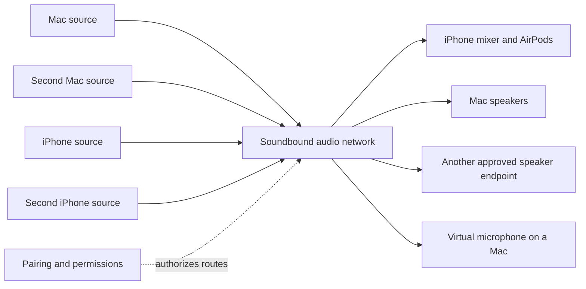
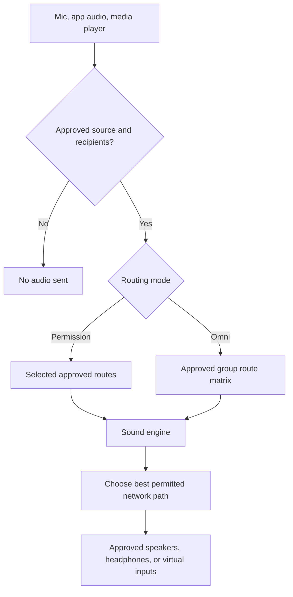
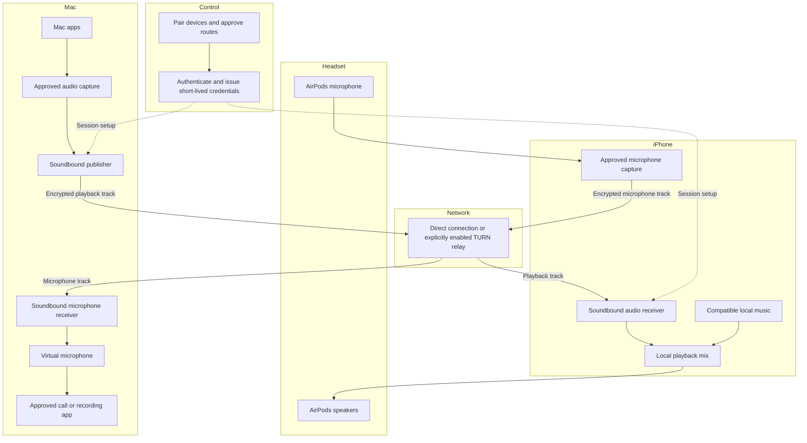
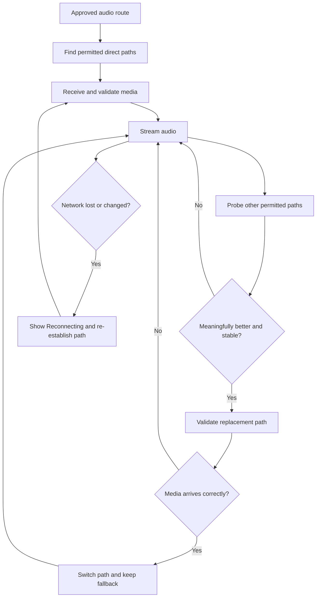
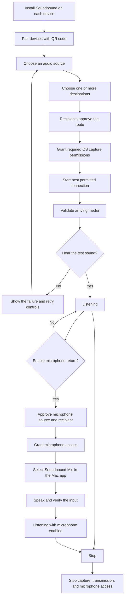

# Soundbound

## A permission-based audio network

Soundbound is a proposed audio engine connecting your computers, phones, headphones, microphones, and speakers. Think of it as a private network for audio: authorized devices can publish sound, receive sound, and mix several approved streams.

The guiding rule is simple:

> You decide who can send sound, who can hear it, and when a microphone is live. Soundbound chooses how an approved connection travels.

This document describes the product direction and implementation plan as of November 11, 2026. It is a design, not a claim that the complete engine already works. “Tailscale for audio” is an analogy for a private device network; this project is not affiliated with Tailscale and does not require a VPN or a TUN interface.

## What changed

The initial experiment was a Mac menu bar utility for reclaiming AirPods from an iPhone. That exposed two different problems:

1. Apple decides when AirPods automatically switch devices. The public APIs investigated do not provide a demonstrated, reliable pre-switch approval hook.
2. A Mac can report the AirPods as its selected output without proving that the user is hearing Mac audio through them.

The revised direction moves control into Soundbound's own audio network. It does not pretend to intercept Apple's native handoff protocol. Headphones remain attached to one endpoint, while the other devices send their audio to that endpoint.

A concrete first use case is:

- AirPods remain connected to an iPhone.
- A Mac sends its audio to Soundbound on that iPhone.
- The iPhone mixes the received stream with compatible local audio, such as music.
- A second Mac or iPhone can join later as an independently authorized source or destination.
- Optionally, the AirPods microphone sends a separate return stream to an approved Mac.

## Product principles

- **Permission before audio.** Joining a network does not automatically authorize capturing, transmitting, playing, or recording audio.
- **Separate source and destination permissions.** Permission to hear a device is not permission to use its microphone.
- **No optimistic success.** “Requested,” “connecting,” “receiving,” and “verified” are different states.
- **Quiet by default.** A small device list, clear routing actions, and restrained notifications.
- **Stop means stop.** Stop capture, stop sending packets, and release microphone access.
- **Free direct connections first.** Use local networking and free STUN-assisted discovery before any separately enabled paid relay.
- **No recording by default.** Live audio is transient; recording would require a separate explicit feature and permission.

## The engine model

Soundbound separates identity, places, devices, and audio routes:

| Concept | Meaning |
| --- | --- |
| Identity | A user or device recognized by a public signing key. |
| Region | A user-defined place or collection of rooms, such as Home or Studio. It is not a cloud datacenter region. |
| Room | A logical listening/sharing group with its own access policy. |
| Device | A paired Mac, iPhone, or other supported endpoint; stationary or movable. |
| Source | A specific audio producer: Mac system audio, a permitted app, a microphone, or media Soundbound itself plays. |
| Destination | A playback device, a local mixer, or a virtual microphone exposed to another app. |
| Route | An approved connection from one source to one or more destinations. |

Several sources may feed one destination. One source may feed several destinations. Every route has its own permission, mute state, volume, connection state, and diagnostics.

The engine is logically shared but need not be one central server carrying all sound. Signed grants carry membership and permissions. An optional control service can distribute requests and presence without becoming the only source of authorization; endpoint apps capture, encode, receive, mix, and play audio. A TURN relay forwards packets when used. It does not need to decode or mix them.



An endpoint's source capabilities depend on its operating system. “iPhone source” does not mean an app can silently capture every other iPhone app, every call, or protected media.

## Regions, rooms, friends, and movable devices

Regions are user-defined places such as **Home**, **Office**, or **Studio**. Rooms are listening groups inside them, such as **Living room**, **Desk**, or **Kitchen**. These names organize people and audio; they do not select a cloud datacenter or imply location tracking.

The menu bar and full app expose the same hierarchy:

```text
Devices
  This Mac
  My iPhone · movable
Regions
  Home
    Living room · 2 speakers
    Desk · 1 Mac
  Studio
    Main room · request to join
Requests
  Pending invitations and access requests
```

### Room access

A room owner chooses a policy:

- **Invite only:** no access without a signed invitation.
- **Request to join:** a requester remains outside until an authorized owner or moderator approves.
- **Allow friends:** established Soundbound friends may join under the room's declared role. Friendship means an explicitly accepted identity relationship, not somebody found in a contact list.

Join permission, listening permission, publishing sound, sharing a microphone, moving room-owned devices, and adjusting shared speakers are separate capabilities. The default friend role can listen; it does not automatically publish a microphone or gain speaker controls. An owner may deliberately configure broader permissions.

The UI says **Request access**, **Waiting for approval**, **Join**, or **Joined**, based on actual authorization state. A pending request must not obtain room keys or receive private audio packets. The owner can approve, decline, revoke, or remove a member.

### Moving devices

Mark a device as stationary or movable. A movable device can be assigned to another room using **Move to…** or by dragging it in the full app. A compact menu uses the same action without requiring a spatial editor.

For the first version, each device has one active room. A move must be authorized by the device owner or someone explicitly granted that control. Revoke the old room's active routes before enabling the destination room's routes, obtain destination approval where required, and acknowledge the applied change before showing the device as moved. Moving an icon must never grant a previously unauthorized room access to its microphone.

Physical movement and network changes do not automatically change room membership. Positioning devices in a layout is organization, not tracking their real-world location.

### Speaker volume

Show a volume control and mute for each available playback endpoint, plus a group control for speakers the user may control. Save endpoint gain separately from individual incoming-stream gain.

On every platform, distinguish **Soundbound playback volume** from **system/hardware volume**. iOS allows control of our own playback gain but reserves system-volume changes to the user through system UI. Use supported hardware controls only where available; do not promise remote iPhone system-volume control. Show pending or failed changes honestly and apply gain ramps to avoid abrupt jumps.

### Sign in with Apple

Offer **Sign in with Apple** as optional onboarding or account recovery/synchronization, not as permission to access all of a person's Apple devices. Apple authentication identifies a person; the device still enrolls its own signing key and joins rooms explicitly. It does not expose an Apple friends list or bypass room permissions. A managed account-sync service would be optional infrastructure, not a requirement for local signed pairing.

## Signed identities and serverless operation

The default security root is a device signing key held in the platform keychain. Use a standard, reviewed signature scheme and protocol implementation, not custom cryptography. Exchange public keys through an explicit pairing ceremony such as a verified QR code. An owner identity may authorize additional device keys.

Signed messages and grants include a protocol version, issuer, intended audience, room/source/destination identifiers, allowed actions, expiry, and a nonce or sequence number. Sign a canonical representation and reject altered messages, wrong audiences, expired grants, and replayed operations. Signatures authenticate instructions; they do not encrypt audio. Media still requires an authenticated encrypted transport.

A room owner signs scoped invitations and grants. Devices validate those grants locally before sharing keys, sending media, or applying control changes. Room owners can delegate limited approval rights to moderators without distributing their private keys.

### What does not require our own server

- Pairing nearby devices with QR codes and local discovery.
- Verifying signed invitations and control messages.
- Enforcing cached, still-valid room permissions on devices.
- Direct media connections when the peers are reachable.
- Manual exchange of connection offers for remote direct sessions.

### What signatures do not solve

- **Discovery:** a signature cannot find an offline or unknown peer. Automatic remote rendezvous needs a reachable peer or an optional directory/signaling service. Manual offer exchange avoids that service at a usability cost.
- **Connectivity:** signatures cannot bypass NAT or a firewall. Free STUN can assist direct discovery; TURN is still needed on networks where a direct path is impossible.
- **Revocation while offline:** a disconnected peer cannot learn an immediate revocation. Use short-lived grants, signed revocation updates, and refreshed room keys. Sensitive room sessions fail closed when required permission state cannot be refreshed; do not claim globally instantaneous revocation without an online authority.
- **Recovery:** losing every trusted private key loses that identity unless the owner has configured a recovery mechanism.
- **Paid relay credentials:** a provider's account-level TURN key cannot be safely embedded in public apps. Optional managed TURN still needs an authorized credential issuer or another provider-supported delegation mechanism.

The promise is **no self-managed application server required for the basic direct mode**, not that the internet needs no infrastructure. Public STUN is external infrastructure; optional signaling, account sync, and TURN can be hosted services. A user's always-on device may also act as a rendezvous peer, with clear availability limits.

## Two layers: network and sound

The public model is:

```text
Network = available links + discovery + secure transport + route policy
Sound   = sources + destinations + permissions + mixing
```

These are separate concerns. A better network path must never create a new permission to capture a microphone, hear a stream, or add a recipient.

| Layer | Parts | Responsibility |
| --- | --- | --- |
| Link or bearer | Wi-Fi, Ethernet, cellular, a supported local link | Carry network packets. |
| Optional tunnel | An existing IP tunnel, including a TUN-backed network | Offer another reachable path; Soundbound does not require or silently create a VPN. |
| Discovery | Local discovery and STUN/ICE | Find candidate ways to connect. STUN does not carry the audio stream. |
| Media transport | WebRTC over a selected direct or TURN-relayed path | Encrypt and transport audio with congestion and loss handling. |
| Local audio | Bluetooth headsets, built-in mic/speaker, wired devices, supported media players | Supply or reproduce audio at an endpoint; Bluetooth is not assumed to be a general peer-to-peer IP link. |
| Sound policy | Source and destination grants, gain, mute, subscriptions, optional recording | Decide which sound is allowed to flow and where. |

The engine chooses among usable network paths using measured latency, jitter, loss, and stability. It does not treat “Wi-Fi,” “STUN,” and “WebRTC” as interchangeable alternatives: a WebRTC session can run over Wi-Fi, use STUN to discover a direct path, and use TURN when relaying is permitted.

### Permission mode and omni mode

- **Permission mode:** create specific approved routes, such as one microphone to one call app or one Mac's sound to two phones.
- **Omni mode:** within an explicitly selected group, distribute all approved shared sources to all approved listening destinations. It is a convenience for creating a route matrix, not permission to listen to every nearby device.
- Each group member must accept participation and any source sharing. A device may listen without publishing a microphone.
- New members, newly added sources, and recording require their own applicable approval; they do not inherit blanket access by entering the group.
- Muting, leaving, or revoking a grant removes the corresponding routes. Apply mixing/feedback rules so a stream is not recaptured and sent around a loop.
- Turning on omni mode does not turn on paid relaying. Network spending permission remains separate from audio-sharing permission.



## First release: free direct connections

The first transport milestone is a working direct audio path between a Mac and an iPhone, using local discovery and free STUN where useful. No paid TURN service is activated by default. When networks prevent a direct connection, report that clearly; never silently enable billable relaying.

Proposed components:

1. **Mac app:** audio capture, publishing, receiving, routing controls, and diagnostics.
2. **iPhone app:** pairing, incoming audio playback, compatible mixing with local playback, and optional microphone publishing.
3. **Control plane:** device-signed pairing and route grants, local discovery, and session negotiation. Remote signaling and account synchronization are optional services. Short-lived TURN credential issuance remains optional and disabled without an explicitly configured relay.
4. **Optional TURN relay:** an explicitly enabled fallback. Cloudflare STUN can assist free direct discovery independently of activating its paid TURN service.
5. **Media engine:** WebRTC-based encrypted audio tracks, with a codec configuration appropriate to music or voice. Opus is the initial codec candidate.

Use a mature WebRTC implementation rather than inventing a new secure media transport. Verify the chosen native library supports injecting captured Mac audio, receiving media without taking over the iPhone audio session as a phone call, and keeping local music mixable.

Default to direct-only connectivity and supply no TURN credentials. If a user separately enables a paid relay, test it using forced-relay mode so transport statistics demonstrate that the test really exercised TURN. Free mode must never obtain billable TURN credentials.



### STUN, TURN, Bluetooth, and TUN are different

- **STUN** helps discover reachable addresses. It is not an audio relay.
- **TURN** relays media packets when selected and explicitly permitted. Paid TURN is off by default.
- **Bluetooth** connects local audio hardware, such as AirPods, to an endpoint. The design does not assume AirPods expose a general-purpose network link between arbitrary computers and phones.
- **TUN** is a virtual network interface used by VPNs. This audio application does not need to route all device traffic through a VPN.
- **Local networking** is a possible future direct transport between endpoints on a reachable network.

The Cloudflare account-level TURN key remains server-side. Apps receive short-lived credentials scoped to their authorized sessions. No account secrets, TURN passwords, private keys, or real device identifiers belong in this repository.

## Automatic route selection

The engine can choose a path for each approved device pair, within that session's network and spending permissions. It should choose among measured, usable paths rather than assume one technology always has the lowest latency.

Candidate paths:

1. A verified direct local connection, if available and allowed.
2. Another verified direct internet path discovered through ICE/STUN.
3. A TURN relay path, only if the user has separately enabled it.

Each candidate needs recent measurements for latency, jitter, loss, and liveness. Select a stable usable path, not merely the one with the smallest single ping. Use hysteresis and a minimum stable interval to prevent rapid route flapping. Keep the existing path until a replacement has passed connectivity and media checks where possible.



Switching the network path for an already approved route does not authorize a new recipient or a new microphone source. Cellular use should have its own user preference. A change of recipient requires approval regardless of whether the old and new recipients are on the same network.

Walking away from the Mac means carrying the phone and headphones while the Mac remains awake and online. A sleeping or offline source cannot continue generating live audio. Wi-Fi-to-cellular transitions may interrupt sound; seamless roaming is a goal to test, not an existing guarantee.

## Permissions and trust

### Device pairing

- Pair through a QR code or short-lived invitation.
- Show the device identity on both ends and require acceptance.
- Bind the accepted identity to cryptographic credentials, not a friendly name or IP address.
- Store device secrets in the platform keychain.
- Support revocation and removal of a lost device.

### Route consent

Before the first stream, show a plain-language request such as:

> “Allow this Mac to send audio to this iPhone?”

Microphone publishing needs a separate request:

> “Allow this iPhone's microphone to send audio to this Mac?”

Permission is scoped to the named source, recipient, and operation. Users can allow once or remember an explicitly chosen route. New devices do not inherit access to existing streams. A new subscriber to a private conversation must not receive audio merely because it joined a room.

### Operating-system permissions

Operating-system prompts remain necessary. The Mac must obtain the applicable audio-capture permission. The phone must obtain microphone permission before capturing microphone audio. The virtual microphone has a separate installation/setup step. Soundbound must not claim its own consent UI replaces operating-system authorization.

### Data handling

- Use encrypted media transport and authenticated signaling.
- Keep account-level cloud credentials off endpoints.
- Issue expiring session credentials and limit their privileges.
- Keep diagnostics free of audio contents, secrets, and private device identifiers by default.
- Show when audio is being sent, where it is going, and when the microphone is live.
- Separate optional recording from live forwarding.
- End-to-end media encryption must be assessed again if a future SFU terminates or processes media; TURN relay encryption must not be conflated with server-side mixing.

## Microphone return

The microphone path is a separate track:

**AirPods microphone → iPhone Soundbound app → network → Mac Soundbound app → virtual microphone → selected Mac app.**

Receiving microphone packets in Soundbound is not enough to make them appear as a system input. The Mac needs a virtual audio device that other applications can select. Apple's Audio Server Driver Plug-in sample is a relevant starting point. Do not assume a plain menu bar app can create a system microphone without that work.

Requirements:

- Microphone off by default.
- Explicit source and recipient approval.
- Clearly visible live/muted state and an immediate mute action.
- No automatic microphone activation just because playback starts.
- Bounded buffers and stale-audio discard after reconnect.
- No automatic local loopback of the microphone to the headset.
- Verify the actual selected input; do not assume it is the AirPods mic.
- Test echo, call interruptions, and Bluetooth input/output quality together.

Some AirPods and operating-system combinations support high-quality Bluetooth recording; others may use a lower-quality hands-free route. Detect capabilities and test the actual route. Do not promise simultaneous high-fidelity music and microphone operation on every headset.

## Mixing and multiple speakers

An endpoint mixes only the streams approved for that destination. Provide independent source gains and mute controls. Bound total gain or apply limiting to avoid clipping when several streams play together.

Multiple iPhones can act as playback endpoints if each has the app, accepts the route, and keeps its playback session available. This is not a claim that arbitrary nearby speakers can join without compatible hardware or a receiver.

Playing the same stream on several speakers adds clock synchronization and output-latency problems. A future synchronized-speaker mode needs:

- Shared media timestamps and receiver clock-offset estimates.
- Jitter buffers and a chosen common playout time.
- Drift correction and route-specific output-latency measurements.
- Tests for echoes and audible misalignment between nearby speakers.

Independent listening on several endpoints can come first. Sample-accurate whole-room synchronization is a separate milestone.

## User flow



The everyday interface should be short:

- **Devices:** online, reconnecting, or offline; stationary or movable.
- **Regions and rooms:** places, room membership, and allowed actions.
- **Requests:** incoming invitations and pending join requests.
- **Volume:** per-endpoint Soundbound gain and mute, with authorized group controls.
- **Send audio:** choose source and approved destinations.
- **Listen:** choose approved incoming streams.
- **Mic:** off, muted, or sending to a named device.
- **Setup:** optional Apple sign-in, signed pairing, friends, permissions, outputs, network preferences, recovery, and diagnostics.

Avoid an overloaded audio-routing dashboard for the first usable version. Detailed transport information can live behind a diagnostics control.

## Honest connection states

Maintain separate states for:

1. A request was sent.
2. The transport connected.
3. Valid audio packets arrived.
4. The receiver's audio output started successfully.
5. The user confirmed an audible test.

A green check must describe the check actually completed. “Sound test confirmed” is not a permanent guarantee of exclusive AirPods ownership. Reset or qualify stale status when the route, device, or connection changes.

A Bluetooth connection, a selected Core Audio output, a successful API callback, or a TURN allocation alone does not prove audible playback.

## Current implementation and evidence

The local workspace currently contains an early native Mac menu bar prototype, not the network engine described here.

Implemented in that prototype:

- Listing local audio devices and paired Bluetooth audio devices.
- Requesting a Mac connection and releasing a Bluetooth connection.
- A small menu and setup instructions.
- A separate sound-test confirmation state instead of optimistic ownership checks.
- Five regression tests covering confirmation, failure, and invalidation of the sound-test state.

Investigated:

- A separate one-shot `AVAudioRoutingArbiter` probe, with and without a brief playback tone.
- The tested requests completed without an API error but did not move the Mac's output from its speakers to the AirPods in those runs.
- Automatic-switch settings were subsequently questioned, so those runs are limited evidence rather than proof that every possible configuration fails.

Not yet implemented or validated:

- A native iPhone app.
- A TURN media transport and credential issuer.
- Multiple network sources or subscribers.
- System microphone exposure on the Mac.
- Automatic network-path selection, roaming, or speaker synchronization.
- A reliable native AirPods pre-handoff veto.

Do not present the existing Bluetooth utility as the completed permission-based network.

## Development milestones

### 1. Control plane and direct-connection proof

Build signed device identities, QR pairing, room/source grants, replay protection, and a direct two-device connection using free discovery paths. Send a generated test stream. Confirm that denial and revocation actually prevent media delivery and that no TURN credentials are obtained in free mode.

### 2. Useful Mac-to-iPhone playback

Capture permitted Mac audio, stream it, and play it through an iPhone-connected headset while compatible iPhone music continues. Test screen lock, background playback, volume controls, disconnection, and reconnect. Measure latency and dropouts rather than announcing an unmeasured target as achieved.

### 3. Multiple devices and routes

Add a second publisher and a second receiver. Verify selective subscriptions, independent mute/gain, no accidental room-wide broadcast, no clipping, and no duplicate playback after reconnect. Set practical device and stream limits based on measurements.

### 4. Microphone return

Publish the approved headset or phone microphone, receive it on the Mac, and expose it through a virtual microphone. Verify it in an independent calling or recording app. Test mute, revocation, background operation, quality changes, and interruptions.

### 5. Automatic path optimization

Add measured route selection, hysteresis, optional approved TURN fallback, existing tunnel paths, and Wi-Fi/cellular transitions. Keep route permissions independent of transport selection.

### 6. Synchronized speaker mode

Add clock synchronization, playout scheduling, drift correction, and multi-speaker testing. Keep this distinct from ordinary multi-recipient streaming.

## Acceptance tests

| Area | Required evidence |
| --- | --- |
| Cost policy | Free mode never obtains TURN credentials or uses a paid relay. |
| TURN, when enabled | Relay-only configuration and transport statistics show the test really used TURN. |
| Omni mode | Every active group route has valid source and destination grants; new devices and microphones are not shared silently. |
| Rooms and friends | A pending or declined join request never receives room media; friend access grants only the configured role. |
| Device movement | Old room routes stop before destination routes begin; a move cannot bypass destination approval. |
| Signed control | Tampered, replayed, expired, and wrong-audience messages are rejected. |
| Revocation | Connected peers apply revocations; offline behavior follows documented grant expiry and fail-closed rules. |
| Volume | Only authorized users can control an endpoint; iPhone app gain is not mislabeled as hardware volume. |
| Permission | A rejected, expired, or revoked route stops or prevents audio packets reaching the recipient. |
| Playback | Intended headset reproduces the test; an accepted API call alone is not a pass. |
| Mixing | Local phone music and the incoming Mac stream are independently audible and controllable. |
| Microphone | Intended input is selected, packets arrive, and an independent Mac app receives them. |
| Privacy | Stop and mute are effective; no audio recording or secret-bearing logs appear unexpectedly. |
| Roaming | Network changes show honest reconnecting state and recover without duplicate or stale audio. |
| Multiple endpoints | Only approved recipients receive the chosen source. |
| Synchronization | Report measured inter-speaker offset and drift before claiming synchronized playback. |
| Power and longevity | Measure CPU, battery use, background behavior, and sustained playback over an extended session. |

## References

- [Apple: AVAudioRoutingArbiter](https://developer.apple.com/documentation/avfaudio/avaudioroutingarbiter)
- [Apple: Bluetooth baseband connection](https://developer.apple.com/documentation/iobluetooth/iobluetoothdevice/openconnection())
- [Apple: capturing Mac screen and audio content](https://developer.apple.com/documentation/screencapturekit/capturing-screen-content-in-macos)
- [Apple: mixing an audio session with other apps](https://developer.apple.com/documentation/avfaudio/avaudiosession/categoryoptions-swift.struct/mixwithothers)
- [Apple: playback and background audio](https://developer.apple.com/documentation/avfaudio/avaudiosession/category-swift.struct/playback)
- [Apple: Bluetooth microphone input](https://developer.apple.com/documentation/avfaudio/avaudiosession/categoryoptions-swift.struct/allowbluetoothhfp)
- [Apple: high-quality Bluetooth recording](https://developer.apple.com/documentation/avfaudio/avaudiosession/categoryoptions-swift.struct/bluetoothhighqualityrecording)
- [Apple: virtual audio-device plug-in](https://developer.apple.com/documentation/coreaudio/creating-an-audio-server-driver-plug-in)
- [Apple: capturing screen content on iOS](https://developer.apple.com/documentation/screencapturekit/capturing-screen-content-on-ios)
- [Apple: screen recording limitations](https://support.apple.com/en-us/102653)
- [WebRTC: peer connections and signaling](https://webrtc.org/getting-started/peer-connections)
- [Cloudflare: TURN service](https://developers.cloudflare.com/realtime/turn/)
- [Cloudflare: short-lived TURN credentials](https://developers.cloudflare.com/realtime/turn/generate-credentials/)
- [Cloudflare: TURN operation, free STUN, and reconnect considerations](https://developers.cloudflare.com/realtime/turn/faq/)
- [RFC 8489: STUN](https://www.rfc-editor.org/rfc/rfc8489)
- [RFC 8656: TURN](https://www.rfc-editor.org/rfc/rfc8656)

- [Apple: Sign in with Apple authentication](https://developer.apple.com/documentation/signinwithapple/authenticating-users-with-sign-in-with-apple)
- [Apple: iOS system volume limitations](https://developer.apple.com/documentation/avfaudio/avaudiosession/outputvolume)
