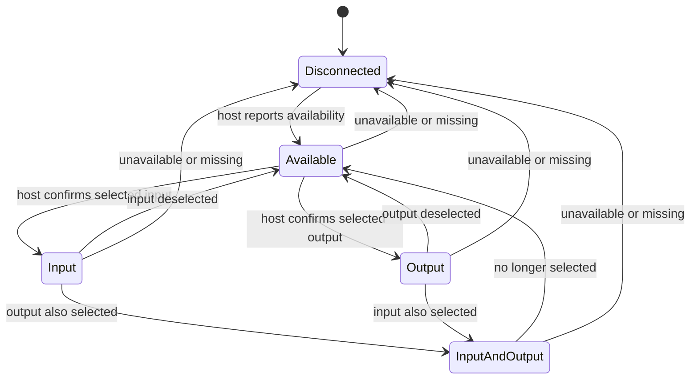
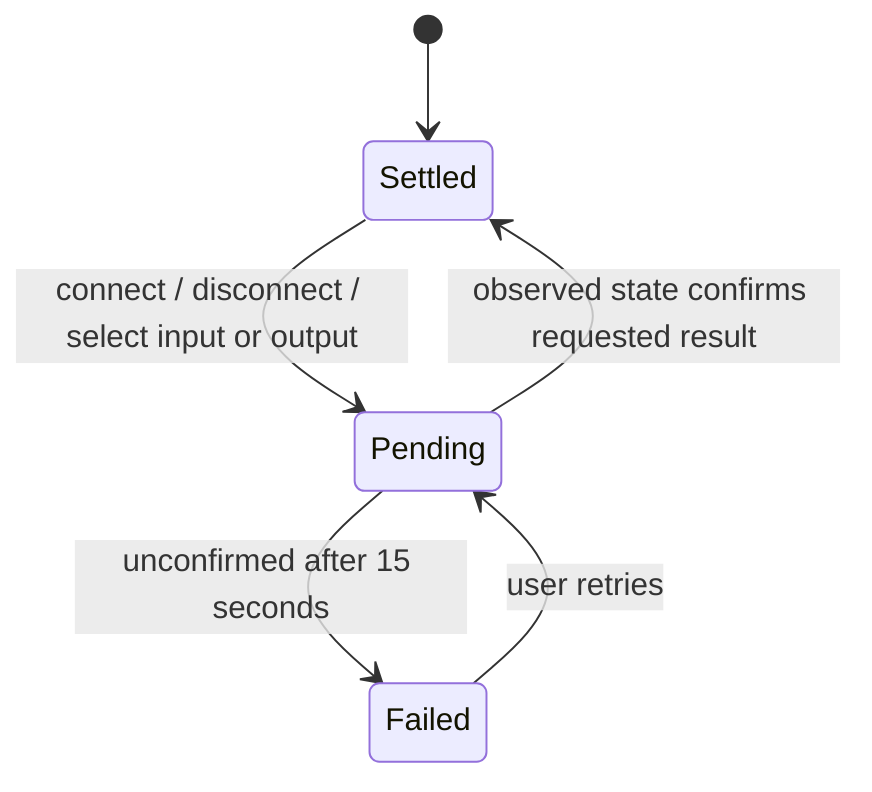

# Device identity and state

Soundbound keeps reported device state separate from requested changes. A request does not prove a connection or route change.

## Identity

Each host reconciles its device inventory before rendering or sharing it. Repeated IDs become one row. Explicit Bluetooth addresses normalize case and separators. Input and output profiles merge only when their platform supplies a shared physical identity. The available/selected report takes precedence over a saved disconnected report.

Names are display labels, not identity: two headphones named “AirPods” remain separate unless an identifier establishes that they are the same device. Bluetooth addresses and iOS audio port IDs are not assumed to be interchangeable across hosts. Cross-host aliases still need a verified association; matching names alone cannot safely establish ownership.

## Implicit state: observed by the system

The latest host snapshot determines this state. Apple switching a route changes the observed state; it does not imply that Soundbound requested or approved the move.

## Explicit state: requested by the user

The row shows a pending action or “Change not confirmed”; it never marks a requested route selected optimistically. Room membership remains a separate relationship, so displaying a device in a room and in the inventory is intentional. Within either list, duplicate reports are reconciled.

Cross-host headphone moves still use the separate signed request/approval protocol. Approval means permission to attempt the move, not a confirmed Bluetooth handoff. Soundbound cannot intercept Apple’s automatic handoff before it happens.
