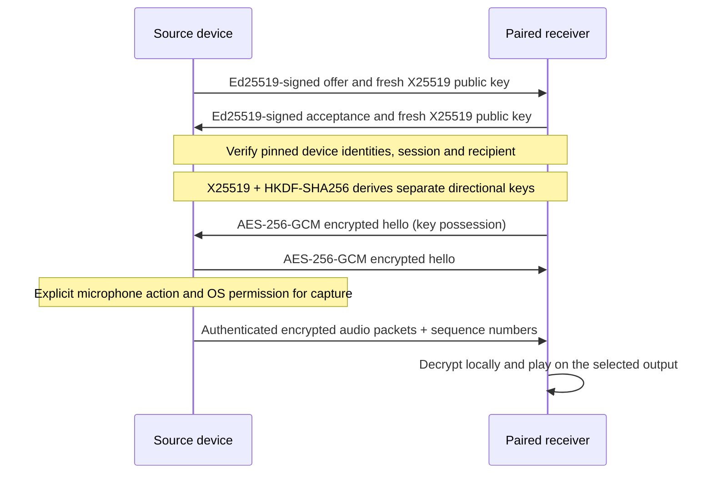
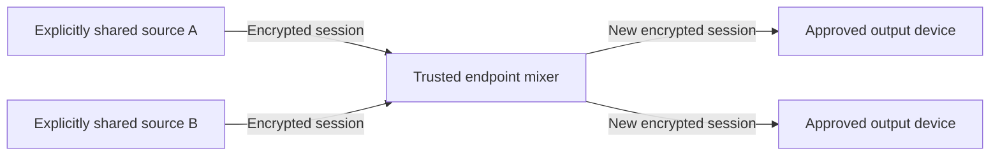

# Audio security

Soundbound has a reasonable prototype cryptographic design, not a production security guarantee. The implementation uses Apple CryptoKit, but the surrounding protocol has not had an independent security audit.

## Current connection

The offer, acceptance, discovery, device names and room layouts are signed where applicable but are not encrypted. An observer on the local network can read metadata and see traffic timing and size. PCM audio travels encrypted and is decrypted in receiver memory for playback.

Trusted-device playback is automatic by default. Trust comes from manual pairing approval or mutual Apple-signed, device-bound account verification on the local network. Account hints alone never grant trust. The receiver still authenticates the sender and sends a signed acceptance; it simply does not ask the user again. Linking never opens a microphone. Holding a local input icon is a separate recording action. See [account linking](APPLE-SIGN-IN.md#linking-a-persons-own-devices) for proof lifetime and sign-out behavior.

## What the primitives provide

- Ed25519 authenticates messages against a device key already trusted by pairing; it does not prove a person's identity.
- Fresh X25519 session keys and HKDF bind directional media keys to the session and both device identities.
- AES-GCM authenticates packet contents and session context. CryptoKit generates nonces; the receiver rejects previously accepted sequence numbers.
- The encrypted hello proves that the receiver has the derived session key before shared microphone capture starts.

These properties depend on the protocol and implementation being correct. Passing tests is not a cryptographic proof.

## Before production

Prefer a reviewed transport such as WebRTC's DTLS-SRTP for internet media, instead of extending the custom TCP protocol indefinitely. Independently review enrollment, fingerprint verification, key replacement/revocation, session lifetimes/rekeying, malformed-message handling, and denial-of-service bounds. The current short human-readable fingerprint deserves particular review; the QR invitation binds to the full device identity.

Development identity keys are stored in a local owner-only JSON file at the user's request. Production uses Keychain. Neither protects against a fully compromised endpoint; keys and decoded audio exist in device memory.

## Room mixing trust boundary

A device that mixes audio must decrypt it first. Mixing therefore belongs on explicitly trusted endpoints. A future TURN relay should forward ciphertext without receiving media keys. Room membership alone must not grant microphone capture or access to session keys.

This second diagram is the intended room mixer, not a claim that multi-source mixing or forwarding is already implemented. The present engine supports one source and receiver per stream; room tests visit outputs in sequence.

References: [TLS 1.3](https://www.rfc-editor.org/rfc/rfc9846.html), [WebRTC security architecture](https://www.rfc-editor.org/rfc/rfc8827.html).
